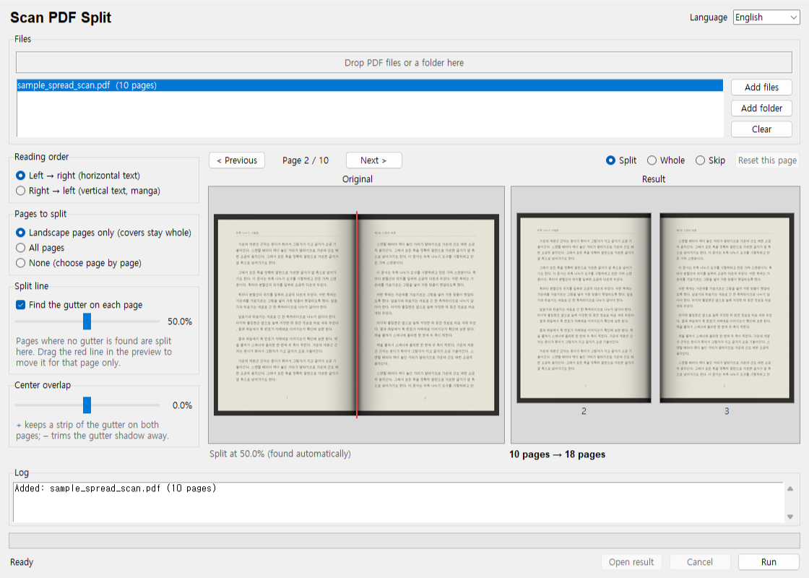

# Chaekgalpi Tools – Two-page Split

[한국어](README.md) · [中文](README.zh-CN.md) · [日本語](README.ja.md)

Splits a PDF scanned two pages per sheet (a book scanned open) into left and right pages, so it can be read one page at a time on an e-reader. Images are never re-compressed: quality stays the same and the file barely grows. No server (except the update check, which can be turned off), no install, the original file is never modified.


## Download

- **Executable**: grab `scan-pdf-split.exe` from [Releases](https://github.com/microhan1/scan-pdf-split/releases) and double-click it. Nothing to install.
- **Run from source**:

```bash
pip install -r requirements.txt
python main.py
```

## Usage



1. Drop PDF files or a folder onto the window.
2. Adjust the options while watching the preview (reading order · pages to split · automatic gutter fitting · center overlap). Step through the pages to drag the red split line, or to set a page to Split, Whole or Skip.
3. Press **Run**. `<name>_split.pdf` is written next to the original.

- Portrait covers are kept whole.
- **Gutter fitting** finds the shadow or the blank margin in the middle of each page and moves the split line there. Pages where nothing is found are split at the split-line setting.
- Rotated pages, links and notes, and bookmarks (the table of contents) follow the split pages.

There is a command line too.

```bash
python main.py book.pdf
python main.py scans/ --direction rtl --overlap 1
python main.py book.pdf --no-auto --position 52
```

`python main.py --help` prints the options in your OS language (한국어 · English · 中文 · 日本語).

## Update check

To see whether a newer version exists, the app sends only the tool name (`scanpdfsplit`) and its version to the 책갈피 (Chaekgalpi) server, chaekgalpi.co.kr, when it starts. No file is sent, it checks at most once a day, and it can be turned off (the **Check for updates** box at the top of the window). The check runs in the background after the window opens; without a connection nothing is shown. The command line never checks.

When a newer version exists, a one-line notice appears at the bottom of the window. **Update** opens the tool's page on the Chaekgalpi site; **Later** hides it and that version is not mentioned again (a newer one is).


*Picture: the notice line at the bottom of the window, in Korean "새 버전 0.2.0이 있습니다 (현재 0.1.3)" (in English: "Version 0.2.0 is available (current 0.1.3)"), shown with a fake server answer (version 0.2.0) for this screenshot.*

## What it does not do

- No OCR. A searchable PDF stays searchable, but a search may also hit words from the neighbouring page.
- Margin cropping and image cleanup are separate tools. This one only splits pages.
- The cut-off half is hidden, not removed; it is still inside the file. Do not use this to hide content.
- It does not straighten tilted scans or turn images stored sideways without a rotation flag.
- It never downloads or replaces itself.

## Series

- Chaekgalpi Tools: [Scan PDF Cleanup](https://github.com/microhan1/scan-pdf-cleanup) · [Margin Crop](https://github.com/microhan1/TrimPDF)
- Browser version, nothing to install: [Spread Split](https://microhan1.github.io/spread-split/)
- [Chaekgalpi Library](https://chaekgalpi.co.kr/tools/scanpdfsplit?utm_source=github&utm_medium=referral&utm_campaign=tool_cta&utm_content=scanpdfsplit) — a web service for logging the books you read and writing reviews (Korean only)

## License

MIT. See [LICENSE](LICENSE).

The released exe bundles [PyMuPDF](https://github.com/pymupdf/PyMuPDF), which is licensed under AGPL-3.0. The source of the exe is this repository. The bundled components and their full license texts are in [THIRD_PARTY_LICENSES.txt](THIRD_PARTY_LICENSES.txt).
