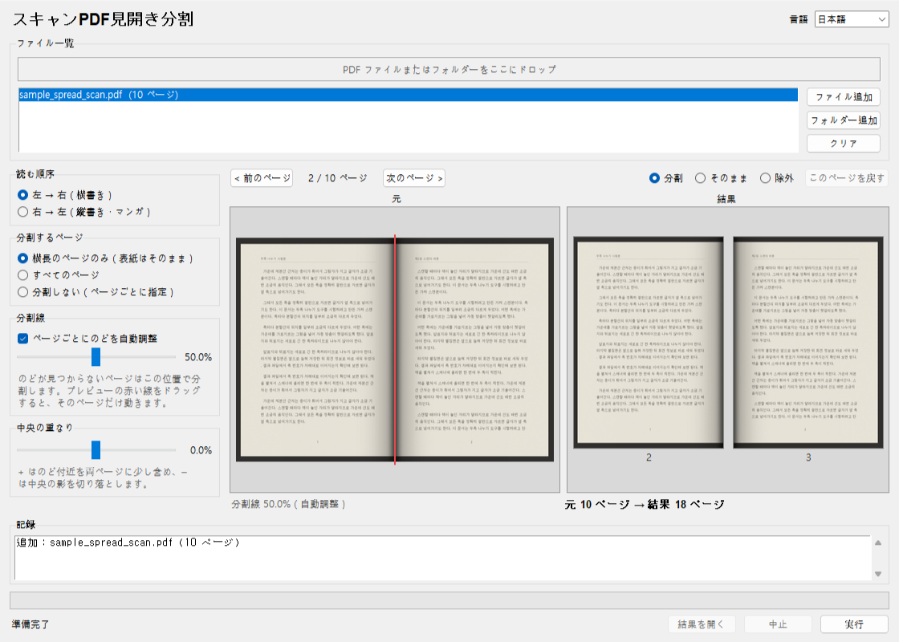

# しおりツール – 見開き分割

[한국어](README.md) · [English](README.en.md) · [中文](README.zh-CN.md)

本を開いてスキャンし 1 枚に 2 ページ写った PDF を左右のページに分け、電子書籍リーダーで 1 ページずつめくれるようにします。画像を再圧縮しないので画質はそのまま、ファイルサイズもほとんど増えません。サーバー不要（新しいバージョンの確認だけは例外、オフにできます）、インストール不要、元のファイルは変更しません。


## ダウンロード

- **実行ファイル**：[Releases](https://github.com/microhan1/scan-pdf-split/releases) から `scan-pdf-split.exe` をダウンロードしてダブルクリック。インストールは不要です。
- **ソースから実行**：

```bash
pip install -r requirements.txt
python main.py
```

## 使い方



1. PDF ファイルまたはフォルダーをウィンドウにドロップします。
2. プレビューを見ながらオプションを調整します（読む順序 · 分割するページ · のどの自動調整 · 中央の重なり）。ページをめくりながら赤い分割線をドラッグしたり、ページごとに分割 / そのまま / 除外を選んだりできます。
3. **実行** を押すと、元のファイルの隣に `<元の名前>_split.pdf` ができます。

- 縦長の表紙は分割せずそのまま残します。
- **自動調整** は各ページの中央でのどの影や余白を探し、分割線をそこへ動かします。見つからないページは分割線の位置オプションどおりに分けます。
- 回転情報のあるページ、リンクと注釈、しおり（目次）も分割後のページに合わせて移ります。

コマンドラインでも使えます。

```bash
python main.py book.pdf
python main.py scans/ --direction rtl --overlap 1
python main.py book.pdf --no-auto --position 52
```

`python main.py --help` で OS の言語（한국어 · English · 中文 · 日本語）のオプション一覧が表示されます。

## 新しいバージョンの確認

起動時に新しいバージョンがあるか確かめるため、ツール名（`scanpdfsplit`）とバージョンだけをしおりサーバー（chaekgalpi.co.kr）に送ります。ファイルは送らず、確認は 1 日 1 回まで、設定でオフにできます（ウィンドウ上部の **新しいバージョンを確認** チェック）。確認はウィンドウが開いた後にバックグラウンドで行い、接続できなければ何も表示しません。コマンドラインで実行したときは確認しません。

新しいバージョンがあると、ウィンドウ下部に 1 行のお知らせが出ます。**更新** を押すとしおりツールのページが開き、**後で** を押すとそのバージョンは再び知らせません（さらに新しいバージョンが出れば知らせます）。


*図：ウィンドウ下部のお知らせ行。韓国語画面で「새 버전 0.2.0이 있습니다 (현재 0.1.3)」（日本語では「新しいバージョン 0.2.0 があります（現在 0.1.3）」）。撮影用に偽のサーバー応答（新バージョン 0.2.0）を入れています。*

## しないこと

- OCR はしません。検索できる PDF は分割後も検索できますが、隣のページの文字も一緒にヒットすることがあります。
- 余白の切り取り、画質補正は別のツールです。このツールはページの分割だけを行います。
- 切り落とした半分は見えなくなるだけで、ファイル内には残ります。内容を隠す目的には使わないでください。
- 傾いたスキャンをまっすぐにしたり、回転情報なしで横向きに保存された画像を回したりはしません。
- 新しいバージョンを自動でダウンロードしたり置き換えたりしません。

## シリーズ

- しおりツール：[スキャンPDF補正](https://github.com/microhan1/scan-pdf-cleanup) · [余白カット](https://github.com/microhan1/TrimPDF)
- インストール不要、ブラウザーで使える Web 版：[見開き分割](https://microhan1.github.io/spread-split/)
- [しおりライブラリ（Chaekgalpi Library）](https://chaekgalpi.co.kr/tools/scanpdfsplit?utm_source=github&utm_medium=referral&utm_campaign=tool_cta&utm_content=scanpdfsplit) — 読んだ本と読書記録を残すウェブサービス（韓国語のみ）

## ライセンス

MIT。[LICENSE](LICENSE) を参照してください。

配布している exe には AGPL-3.0 ライセンスの [PyMuPDF](https://github.com/pymupdf/PyMuPDF) が含まれています。exe のソースはこのリポジトリです。同梱コンポーネントとライセンス全文は [THIRD_PARTY_LICENSES.txt](THIRD_PARTY_LICENSES.txt) にあります。
