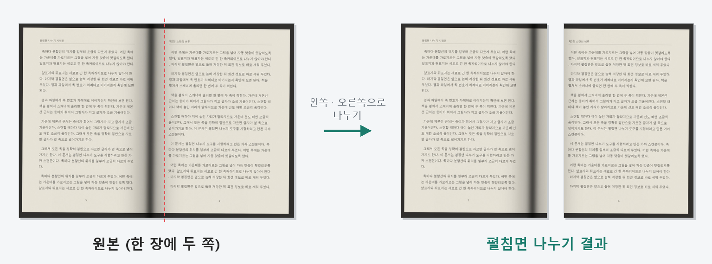
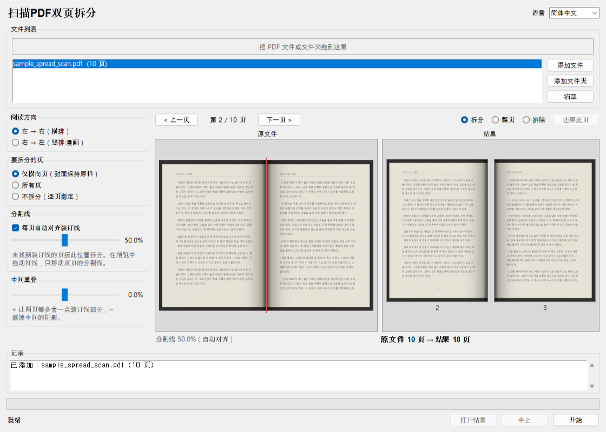
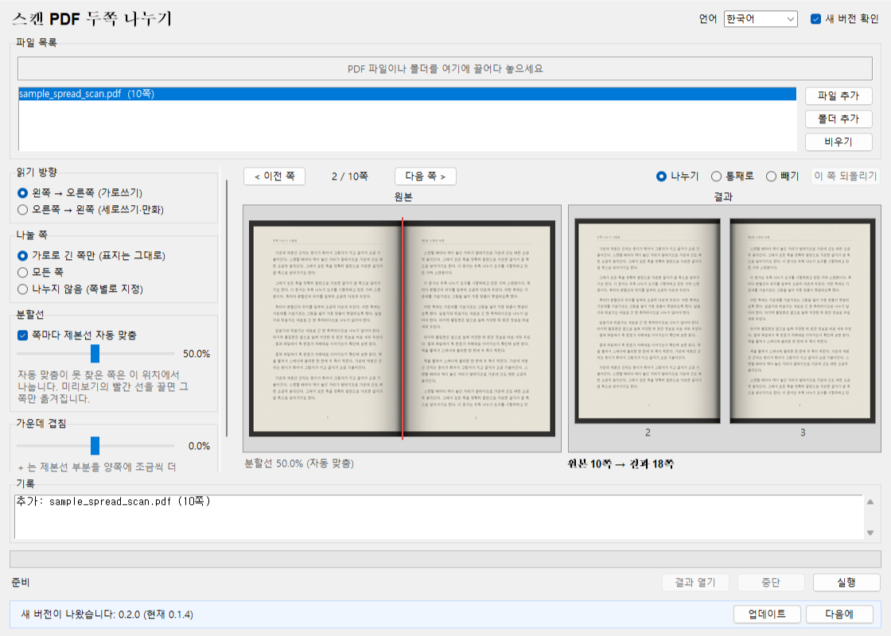

# 书签工具 – 双页拆分

[한국어](README.md) · [English](README.en.md) · [日本語](README.ja.md)

把摊开扫描、一张含两页的 PDF 拆成左右单页，方便在电子书阅读器上逐页翻阅。不重新压缩图片，画质不变，文件大小也几乎不增加。无需服务器（检查新版本除外，可关闭），无需安装，原文件不会被修改。



## 下载

- **可执行文件**：从 [Releases](https://github.com/microhan1/scan-pdf-split/releases) 下载 `scan-pdf-split.exe`，双击即可运行，无需安装。
- **从源码运行**：

```bash
pip install -r requirements.txt
python main.py
```

## 使用方法



1. 把 PDF 文件或文件夹拖到窗口中。
2. 一边看预览一边调整选项（阅读方向 · 要拆分的页 · 自动对齐装订线 · 中间重叠）。可以逐页翻看，拖动红色分割线，或把某页设为拆分 / 整页 / 排除。
3. 点击 **开始**，原文件旁会生成 `<原文件名>_split.pdf`。

- 竖向的封面保持原样，不拆分。
- **自动对齐**会在每页中间寻找装订线的阴影或空白边距，并把分割线移到那里。找不到的页按分割线位置选项拆分。
- 带旋转信息的页、链接与批注、书签（目录）都会随拆分后的页一起调整。

也可以使用命令行。

```bash
python main.py book.pdf
python main.py scans/ --direction rtl --overlap 1
python main.py book.pdf --no-auto --position 52
```

`python main.py --help` 会按系统语言（한국어 · English · 中文 · 日本語）显示选项。

## 检查新版本

启动时为了确认是否有新版本，只把工具名（`scanpdfsplit`）和版本号发送到书签服务器（chaekgalpi.co.kr）。不发送任何文件，每天最多检查一次，并可在设置中关闭（窗口上方的 **检查新版本** 复选框）。检查在窗口打开后于后台进行，无法连接时不显示任何内容。命令行运行时不检查。

有新版本时，窗口底部会出现一行提示。点 **更新** 会打开书签工具页面，点 **以后** 则不再提示该版本（有更新的版本时会再次提示）。



*图：窗口底部的提示行，韩文界面显示「새 버전이 나왔습니다: 0.2.0 (현재 0.1.4)」（中文为「有新版本 0.2.0（当前 0.1.4）」）。截图时使用了伪造的服务器应答（新版本 0.2.0）。*

## 不做的事

- 不做 OCR。可搜索的 PDF 拆分后仍可搜索，但可能同时搜到相邻页的文字。
- 裁剪边距、画质修正是另外的工具。本工具只负责拆页。
- 被裁掉的一半只是被隐藏，仍保留在文件中。请勿用于遮盖内容。
- 不校正倾斜的扫描，也不旋转没有旋转信息、横着保存的图片。
- 不会自动下载或替换新版本。

## 系列

- 书签工具：[扫描PDF清晰化](https://github.com/microhan1/scan-pdf-cleanup) · [边距裁剪](https://github.com/microhan1/TrimPDF)
- 无需安装、在浏览器中使用的网页版：[跨页拆分](https://microhan1.github.io/spread-split/)
- [书签图书馆（Chaekgalpi Library）](https://chaekgalpi.co.kr/tools/scanpdfsplit?utm_source=github&utm_medium=referral&utm_campaign=tool_cta&utm_content=scanpdfsplit) — 记录读过的书和读书笔记的网页服务（仅韩语）

## 许可证

MIT。详见 [LICENSE](LICENSE)。

发布的 exe 包含 AGPL-3.0 许可的 [PyMuPDF](https://github.com/pymupdf/PyMuPDF)。exe 的源代码即本仓库。所含组件及其许可证全文见 [THIRD_PARTY_LICENSES.txt](THIRD_PARTY_LICENSES.txt)。
